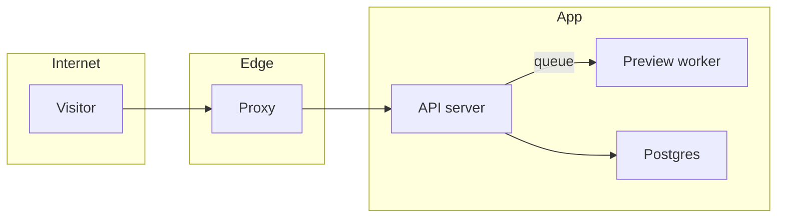

> Illustration only: a shortened `shortlink-threat-model.md` for a made-up URL shortener, to show the shape of the output.

# Threat model: shortlink

## Executive summary

The highest risks sit at the redirect resolver and the admin API: anyone can create links, the resolver follows stored
targets without re-checking them, and the admin API trusts a header set by the proxy. Abuse for phishing and an admin
bypass behind a misconfigured proxy dominate the ranking.

## Scope and assumptions

- In scope: `server/`, `worker/`, `deploy/`. Out of scope: `docs/`, `examples/`, load tests.
- Assumptions (confirmed by the owner on 2026-11-24): internet-facing, single tenant, no personal data beyond email.
- Open question: is the admin API reachable only through the proxy? (changes TM-002 from high to low)

## System model

### Primary components

- API server (`server/app.ts`), redirect resolver (`server/resolve.ts`), preview worker (`worker/preview.ts`),
  Postgres (`server/db.ts`), reverse proxy (`deploy/nginx.conf`).

### Data flows and trust boundaries

- Internet -> Proxy -> API server: link targets, emails; HTTPS; no auth for create; rate limit 30/min per IP
  (`deploy/nginx.conf` `limit_req`).
- API server -> Preview worker: target URLs via queue; no validation of scheme or host (`worker/preview.ts` `fetchPage`).
- Proxy -> Admin API: `X-Admin-User` header is trusted as identity (`server/admin.ts` `requireAdmin`).

#### Diagram

## Threat model table

| Threat ID | Threat source | Prerequisites | Threat action | Impact | Impacted assets | Existing controls (evidence) | Gaps | Recommended mitigations | Detection ideas | Likelihood | Impact severity | Priority |
| --- | --- | --- | --- | --- | --- | --- | --- | --- | --- | --- | --- | --- |
| TM-001 | Anonymous user | None | Preview worker fetches `http://169.254.169.254/` | Cloud credential theft | Instance credentials | None found | No scheme/host allowlist in `fetchPage` | Allow only https and public IPs after DNS resolution; disable redirects | Alert on worker requests to private ranges | high | high | critical |
| TM-002 | Anonymous user | Admin API reachable without the proxy | Send forged `X-Admin-User` | Full admin access | Links, settings | Proxy sets header (`deploy/nginx.conf`) | App trusts header from any source | Verify a signed token in `requireAdmin`; bind admin port to localhost | Log admin calls without proxy marker | medium | high | high |

## Focus paths for security review

| Path | Why it matters | Related Threat IDs |
| --- | --- | --- |
| `worker/preview.ts` | Fetches attacker-chosen URLs from inside the network | TM-001 |
| `server/admin.ts` | Identity comes from a request header | TM-002 |
